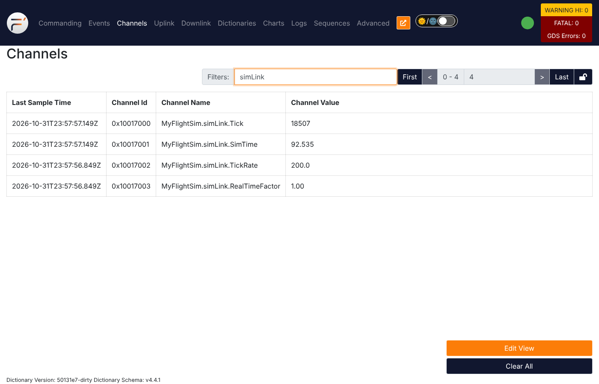
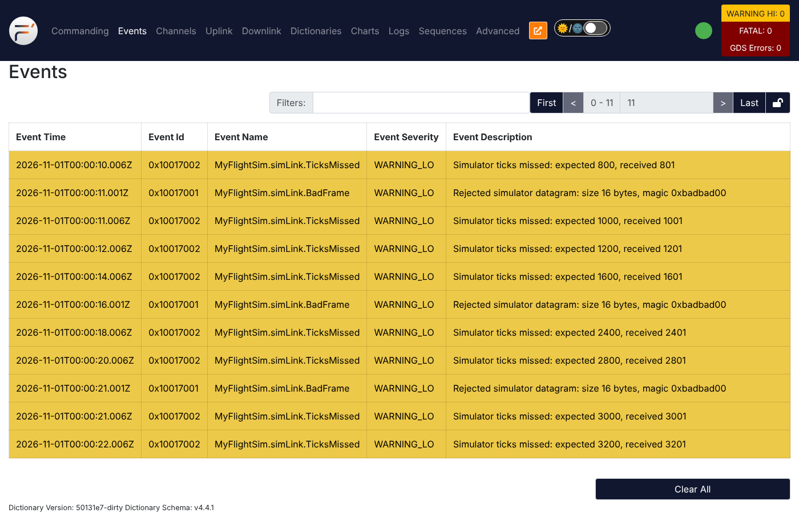

# 02 — Our first component: `SimLink`, and a clock driven by the simulator

**Branch:** `feature/02-simlink-sim-clock` (builds on `feature/01-quadfsw-deployment`)

**Goal:** write our first F´ component and make **the simulator the system
clock**. After this feature:

* a tiny Python "simulator" (`sim/clock_sim.py`) sends one UDP datagram every
  5 ms (200 Hz),
* the F´ `Drv.Udp` driver receives the datagrams and passes them to our new
  `SimLink` component,
* `SimLink` checks each datagram and turns it into one **tick** for the rate
  groups, replacing the 1 Hz `LinuxTimer` from feature 01.

There's still no physics. That comes in feature 03, which builds on this link.

```
 sim/clock_sim.py ──UDP :50100──► simUdp (Drv.Udp) ──$recv──► simLink (SimLink)
                                       ▲                         │ cycleOut
                                       └──recvReturnIn───────────┤
                                                                 ▼
                                                rateGroupDriver (Svc.RateGroupDriver)
                                                 │ ÷1           │ ÷20          │ ÷200
                                                 ▼              ▼              ▼
                                         rateGroup_200Hz  rateGroup_10Hz  rateGroup_1Hz
                                         (empty for now)  tlmSend, cmdDisp, health, simLink.schedIn,
                                                          comQueue, cmdSeq  systemResources, ...
```

---

## 1. The F´ concepts this branch uses

### 1.1 A component, modeled in FPP

> "In F Prime, the *component* is the basic unit of FSW function. An F Prime
> component is similar to a class in an object-oriented language."
>
> — FPP User's Guide, **§11 Defining Components**
> (<https://nasa.github.io/fpp/fpp-users-guide.html#Defining-Components>)

The same section describes the three kinds:

> "An active component has a thread of control and a message queue. A queued
> component has a message queue, but no thread of control; control runs on
> another thread, such as a rate group thread. A passive component has no thread
> of control and no message queue; it is like a non-threaded function library."

`SimLink` is **passive**. It has no thread of its own and runs on its callers'
threads: the Udp receive thread and the 1 Hz rate group thread. See
`MyFlightSim/Components/SimLink/SimLink.fpp`.

**How the component was created** (the official workflow):

```bash
cd MyFlightSim/Components
fprime-util new --component      # name SimLink, passive, telemetry+events, no commands/params
# ... edit SimLink.fpp ...
cd SimLink && fprime-util impl   # generates SimLink.template.hpp/.cpp with every handler stub
```

`fprime-util impl` reads the model and writes C++ stubs for every handler you
must implement. You copy what you need into `SimLink.hpp/.cpp`.

### 1.2 Port kinds: why `guarded`, not `sync`

> "`sync` `input`: Input that invokes a handler defined in this component, and
> run on the thread of the caller.
>
> `guarded` `input`: Similar to sync input, but the handler is guarded by a
> mutual exclusion lock."
>
> — FPP User's Guide, **§11.2 Port Instances** › *Basic Port Instances*

F´ v4 ships a ready-made *port interface* for talking to drivers,
`Drv.ByteStreamDriverClient` (`lib/fprime/Drv/Interfaces/ByteStreamDriver.fpp`;
see FPP User's Guide **§12 Defining and Using Port Interfaces**). We
**didn't** `import` it, because it declares the receive port as `sync`.
`SimLink.drvReceiveIn` runs on the Udp thread and `SimLink.schedIn` runs on
the 1 Hz rate group thread, and both touch the same counters. So we declared
the same ports ourselves as **`guarded`**, and the generated base class locks
the component mutex around each handler. Concurrency handled in the model, not
in hand-written code: that is the F´ way.

### 1.3 Events and telemetry, including throttling

In `SimLink.fpp`:

```fpp
event TicksMissed(expected: U32, received: U32) severity warning low \
  format "Simulator ticks missed: expected {}, received {}" \
  throttle 5 every { seconds = 10 }

telemetry TickRate: F32 format "{.1f}"
```

From the model, FPP generates `log_WARNING_LO_TicksMissed(...)` and
`tlmWrite_TickRate(...)`, which we call from C++. It also adds the event and
channel to the dictionary, so the GDS knows their names. And because of the
pattern specifiers from feature 01 (`event connections instance ...`),
**we wrote zero wiring** for them.

Why throttle? FPP User's Guide **§11.6 Events** › *Throttling*:

> "Sometimes it is necessary to throttle events, to ensure that they do not
> flood the system. … After an instance of the component has emitted the event
> *n* times, it will stop emitting the event."

and, for the `every` form we used:

> "You can also specify in FPP that the throttling for an event should be reset
> automatically after a specified amount of time."

### 1.4 An FPP struct as a wire format

`MyFlightSim/Types/SimTypes.fpp` defines the datagram header:

```fpp
struct SimHeader {
  magic: U32
  tick: U32
  simTimeUs: U64
}
```

FPP User's Guide **§6.2 Struct Type Definitions**: a struct type "specifies a
mapping from element names to their types. As discussed below, it also
specifies a serialization order for the struct elements."

FPP User's Guide **§18.4 Serialization of FPP Values**:

> "Every value represented in FPP can be *serialized*, i.e., converted into a
> machine-independent sequence of bytes. … A value of unsigned integer type
> (`U8`, `U16`, `U32`, or `U64`) is serialized into big-endian order (most
> significant byte first) by default"

So the Python simulator can build the exact same bytes with
`struct.pack(">IIQ", ...)`, and `SimLink` decodes them with the **generated**
`SimHeader::deserializeFrom()`. No hand-written parsing.

### 1.5 A stock F´ driver: `Drv.Udp`

We didn't write any socket code. `Drv.Udp` is part of F´:

> "The UDP client component bridges the byte stream driver model interface to a
> remote UDP port to which this udp component sends/receives bytes. It
> implements the callback formation (shown below) using a thread to receive data
> and producing the callback port call."
>
> — `lib/fprime/Drv/Udp/docs/sdd.md`, *Drv::Udp UDP Component*

Swap `Drv.Udp` for a UART driver and `SimLink` wouldn't change, because both
speak the same `Drv.ByteStreamData` port type. That interchangeability is
the point of ports.

### 1.6 Buffer pools: no `malloc` while flying

Each received datagram arrives in an `Fw::Buffer` that `simUdp` borrows from
`simBufferManager` (a `Svc.BufferManager` with 4 × 1024-byte buffers, allocated
once at startup). `SimLink` **must** give every buffer back
(`drvReceiveReturnOut`), even for bad datagrams.

> "In embedded systems, dynamic memory allocation (a.k.a heap allocation) is
> typically avoided to reduce the steady-state variability in a running system.
> … Safe dynamic allocation is available using the buffer pool pattern in F´,
> implemented through the `Svc::BufferManager` component."
>
> — F´ docs, *Buffer Pools with Svc.BufferManager*
> (`lib/fprime/docs/user-manual/framework/memory-management/buffer-pool.md`)

The same page has a section *Design Pattern: Return-To-Sender*, which is
exactly what `drvReceiveReturnOut → simUdp.recvReturnIn → simBufferManager` does.

### 1.7 Init specifiers: setup code next to the instance

`Drv.Udp` needs `configureRecv()`, `start()`, `stop()`, `join()`.
`Svc.BufferManager` needs `setup()`. Instead of adding these to
`QuadFswTopology.cpp`, we wrote them in `instances.fpp`:

```fpp
instance simUdp: Drv.Udp base id 0x10015000 {
  phase Fpp.ToCpp.Phases.configComponents """
  (void) simUdp.configureRecv("127.0.0.1", SimConfig::FSW_RECV_PORT, SimConfig::DATAGRAM_BUFFER_SIZE);
  ...
  """
  phase Fpp.ToCpp.Phases.startTasks """
  simUdp.start(Os::TaskString("SimUdpRecv"), SimConfig::RECV_PRIORITY, Default::STACK_SIZE);
  """
  ...
}
```

> "An init specifier names a phase of the setup or teardown process and provides
> a snippet of literal C++ code. The FPP translator pastes the snippet into the
> setup or teardown code according to the phase named in the specifier."
>
> — FPP User's Guide, **§13.3 Init Specifiers**

To see the result, open the generated
`build-fprime-automatic-native/MyFlightSim/QuadFsw/Top/QuadFswTopologyAc.cpp` and
search for `configureRecv`. It's inside `configComponents()`.

### 1.8 Replacing the system clock

> "A system clock source needs to be supplied to the rate group driver. … Most
> projects implement a clock component that translates between the system clock
> and the port call to rate group driver's `CycleIn` port."
>
> — F´ docs, *Rate Groups and Timeliness* › **System Clock Sources**
> (`lib/fprime/docs/user-manual/design-patterns/rate-group.md`)

`SimLink` is exactly that clock component. The changes:

* `topology.fpp`: `timer.CycleOut -> rateGroupDriver.CycleIn` became
  `simLink.cycleOut -> rateGroupDriver.CycleIn`.
* `QuadFswTopology.cpp`: the divisors became `{1, 20, 200}` for a 200 Hz base
  rate, giving **200 Hz / 10 Hz / 1 Hz** rate groups. The `LinuxTimer`
  instance was removed.
* `Main.cpp`: `startRateGroups()` (which used to run the timer loop) became
  `waitForShutdown()`, because there's nothing left to start.
* `QuadFswTopologyDefs.hpp`: the health `PingEntries` use the new rate group
  names (the health component pings every active component).

### 1.9 Unit tests from a generated harness

> "Test framework classes include the auto-generated *TesterBase*, the
> auto-generated *GTestBase*, and the developer-written *Tester*."
>
> — F´ docs, *Unit Testing in F´*
> (`lib/fprime/docs/user-manual/overview/unit-testing.md`)

`fprime-util impl --ut` generated the test skeleton. In
`test/ut/SimLinkTester.cpp`, everything like `invoke_to_drvReceiveIn(...)`,
`ASSERT_from_cycleOut_SIZE(3)`, `ASSERT_EVENTS_TicksMissed(0, 3, 5)` and
`ASSERT_TLM_Tick(2, 3)` was **generated from `SimLink.fpp`**. We only wrote the
test logic. Each test maps to a requirement in
`MyFlightSim/Components/SimLink/docs/sdd.md`.

---

## 2. Files to read, in this order

1. `MyFlightSim/Types/SimTypes.fpp`: the datagram header.
2. `MyFlightSim/Components/SimLink/SimLink.fpp`: the component model.
3. `MyFlightSim/Components/SimLink/SimLink.cpp`: start at `drvReceiveIn_handler`,
   then `processDatagram`.
4. `MyFlightSim/Components/SimLink/docs/sdd.md`: requirements and design.
5. `MyFlightSim/QuadFsw/Top/instances.fpp`: scroll to "Simulator link".
6. `MyFlightSim/QuadFsw/Top/topology.fpp`: `connections RateGroups` and
   `connections Simulator`.
7. `MyFlightSim/Components/SimLink/test/ut/SimLinkTester.cpp`: the unit tests.
8. `sim/clock_sim.py`: the "simulator".

Tip: `git diff feature/01-quadfsw-deployment feature/02-simlink-sim-clock -- MyFlightSim/QuadFsw`
shows every change made to the deployment.

---

## 3. Build and unit test

```bash
. fprime-venv/bin/activate
```

```bash
cd MyFlightSim/QuadFsw
```

```bash
fprime-util build -j4
```

(If you switched from another branch and the build complains, run
`fprime-util generate --force` first.)

Run the unit tests for `SimLink`:

```bash
cd ../Components/SimLink
```

```bash
fprime-util generate --ut
```

```bash
fprime-util check
```

**Expect** six tests and `100% tests passed`:

```
[       OK ] Nominal.ValidFramesDriveClock
[       OK ] Nominal.MissedTicksReported
[       OK ] Nominal.SimulatorRestart
[       OK ] OffNominal.BadMagicRejected
[       OK ] OffNominal.ShortDatagramRejected
[       OK ] OffNominal.DriverErrorIgnored
[  PASSED  ] 6 tests.
```

---

## 4. Run it and test it

You need **two terminals**, both with the venv active.

**Terminal 1**, the ground system plus flight software:

```bash
cd MyFlightSim/QuadFsw
```

```bash
fprime-gds
```

### Test 1: no simulator means no clock, so the flight software is frozen

With only `fprime-gds` running, open <http://localhost:5000>:

* **Channels** stays empty: the telemetry rate group (10 Hz) never runs.
* Send `CdhCore.cmdDisp.CMD_NO_OP`. The command **is** executed (the command
  dispatcher is an active component with its own thread), but its events
  don't reach you. The downlink path (`comQueue`, `aggregator`) is driven by
  the 10 Hz rate group, so they wait in the queue.

This is the behavior we want: a lock-step simulation pauses everything when
the simulator pauses.

### Test 2: start the clock

**Terminal 2**, from the repository root:

```bash
python3 sim/clock_sim.py
```

**Expect:**

* **Events**: the queued `NoOpReceived` / `OpCodeCompleted` from Test 1 show up,
  followed by `MyFlightSim.simLink.SimConnected` "Simulator connected; first tick 0".
* **Channels** (type `simLink` in *Filters*):
  * `MyFlightSim.simLink.Tick` increasing by about 200 per second
  * `MyFlightSim.simLink.SimTime` in seconds
  * `MyFlightSim.simLink.TickRate` ≈ **200.0**
  * `MyFlightSim.simLink.RealTimeFactor` ≈ **1.00**



* `MyFlightSim.rateGroup_10Hz.RgMaxTime`: how long the 10 Hz group's work
  took (in µs). That's rate-group timing telemetry for free.

### Test 3: change the speed of time

Stop the simulator (Ctrl-C in terminal 2). **Expect** all channels to stop
updating: the flight software is frozen again. Then run:

```bash
python3 sim/clock_sim.py --speed 2
```

**Expect** `TickRate` ≈ **400** and `RealTimeFactor` ≈ **2.00**. The flight
software runs twice as fast as the wall clock, and nothing in it had to change.
(Watch `SimConnected` appear again: the tick number went back to 0.)

### Test 4: off-nominal input

```bash
python3 sim/clock_sim.py --drop-every 400 --bad-every 1000
```

**Expect** in **Events**:

* `MyFlightSim.simLink.TicksMissed` (WARNING_LO), "expected 2400, received
  2401", about every 2 s
* `MyFlightSim.simLink.BadFrame` (WARNING_LO), "size 16 bytes, magic
  0xbadbad00", every 5 s (on feature 03 and later branches the datagrams are
  full 88-byte `SensorFrame`s, so this says "size 88 bytes")
* at most 5 of each per 10 s (the `throttle 5 every { seconds = 10 }` from §1.3)
* in **Channels**, `TicksMissedTotal` and `BadFramesTotal` counting up



Ctrl-C both terminals when done.

---

## 5. Things to try

* Change `throttle 5 every { seconds = 10 }` on `TicksMissed` to just
  `throttle 3`, rebuild, run Test 4. After 3 events it goes quiet for good,
  until the flight software restarts.
* Make `drvReceiveIn` a `sync` port instead of `guarded`, rebuild, and look at
  the generated `SimLinkComponentAc.cpp`: find `drvReceiveIn_handlerBase` and
  compare. (The guarded version calls `this->lock()` / `this->unLock()`.)
* Add a unit test checking that `SimTime` is reported in seconds for a large
  `simTimeUs` value (e.g. 3 600 000 000 µs = 1 hour).
* Gotcha we hit while writing this: an event parameter named `size` fails
  with `error: ) expected`, because `size` is an FPP **keyword** (`queue size`,
  `stack size`). We used `numBytes`. (FPP lets you escape keywords with `$`,
  e.g. `$size`, which is why you see `$health` and `$recv` in F´ models.)

---

## 6. What's next

**Feature 03** replaces `clock_sim.py` with a real physics simulation of a
quadcopter and a 3D web viewer. `SimLink` grows to carry sensor data in and
motor commands out, and we add our first **commands**.
