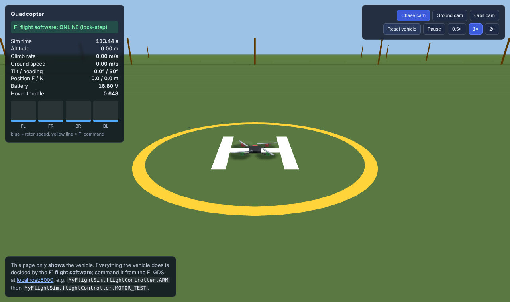
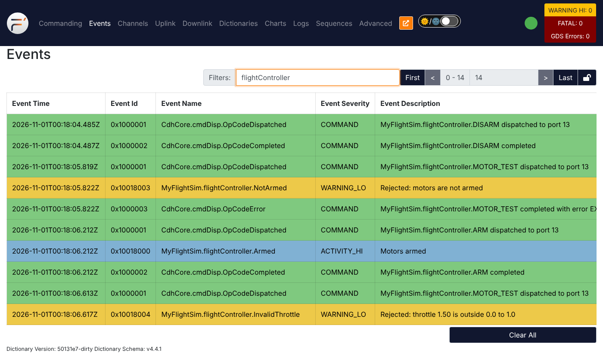
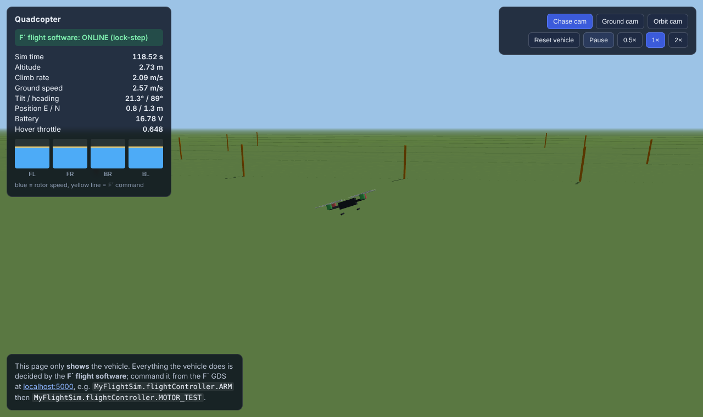
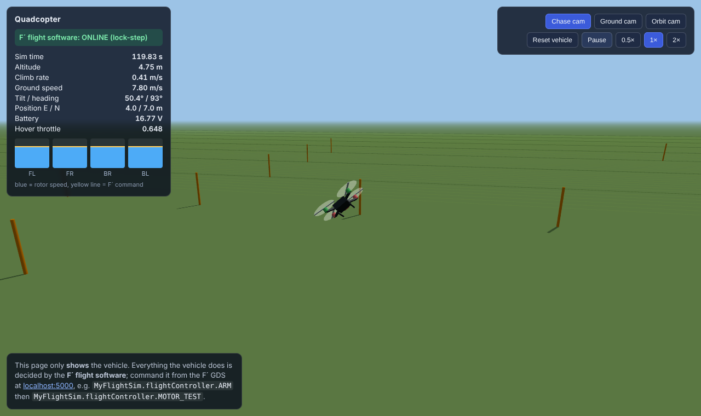
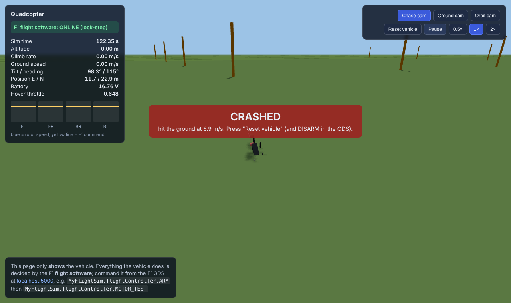
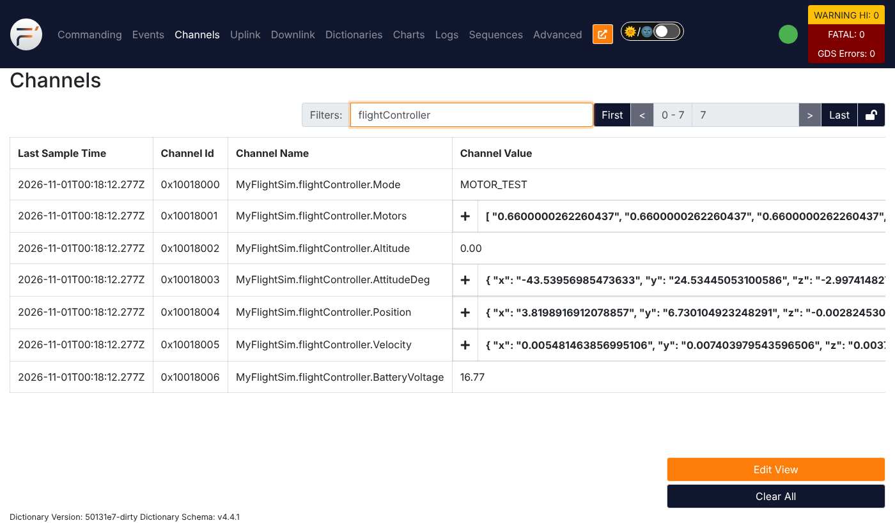

# 03 — Physics, a 3D viewer, and our first commands: `FlightController`

**Branch:** `feature/03-physics-viewer-motors` (builds on `feature/02-simlink-sim-clock`)

**Goal:** give the flight software a real vehicle to control. After this feature:

* `sim/server.py` simulates a 1.2 kg quadcopter (rigid-body physics, rotors,
  drag, ground contact, battery) and serves a **3D viewer** at
  <http://localhost:8080>.
* Every 5 ms it sends **sensor data** to F´ and waits for **motor throttles**
  back (lock-step).
* A new **queued** component, `FlightController`, has three **commands**:
  `ARM`, `DISARM` and `MOTOR_TEST(level)`. You send them from the F´ GDS and
  watch the quad react in 3D.

There is deliberately **no stabilization yet**. `MOTOR_TEST` drives all four
motors at the same throttle, so the quad lifts off, slowly tips over (tiny
differences between real motors), and crashes. That is the motivation for
feature 04.

```
                        ┌──────────────────────── F´ QuadFsw ─────────────────────────┐
 sim/server.py          │                                                             │
 (physics, 200 Hz) ─SensorFrame─► simUdp ─► simLink ──cycleOut──► rateGroupDriver    │
        ▲               │                  │  ▲   ▲                      │ 200 Hz     │
        │               │                  │  │   │                      ▼            │
        │               │                  │  │   └─[1] actuatorSchedIn ◄─ rateGroup_200Hz
        │               │       sensorsGet │  │ motorsIn                 │ [0]        │
        │               │                  ▼  │                          ▼            │
        └─ActuatorFrame─┼── simUdp ◄─────  flightController  ◄── run ────┘            │
                        │                   ▲ ARM / DISARM / MOTOR_TEST (async, queued)│
                        └───────────────────┼─────────────────────────────────────────┘
                                 CdhCore.cmdDisp ◄── GDS (localhost:5000)
 web/ viewer (localhost:8080) ◄─WebSocket─ sim/server.py
```

> The physics and the viewer are just scenery so we have something real to fly.
> This guide is about the **F´** parts.

---

## 1. The F´ concepts this branch uses

### 1.1 Defining our own ports, including a port that returns a value

`MyFlightSim/Types/VehiclePorts.fpp`:

```fpp
@ Read the most recent sensor data
port SensorsGet -> SensorData

@ Set the throttle of all four motors
port MotorsSet(throttles: MotorThrottles)
```

> "Optionally, you can give a port definition a return type. … Invoking a port
> with a return type is like calling a function with a return value. Such a
> port may be used only in a synchronous context (i.e., as a direct function
> call, not as a message placed on a concurrent queue)."
>
> — FPP User's Guide, **§9.5 Returning Values**
> (<https://nasa.github.io/fpp/fpp-users-guide.html#Defining-Ports_Returning-Values>)

That's why `SimLink.sensorsGet` is a `guarded input` (synchronous), not
`async`. In C++ the flight controller just writes
`const SensorData sensors = this->sensorsGet_out(0);`.

### 1.2 Hardware abstraction through ports

`FlightController` has no idea a simulator exists. It only knows "something
gives me `SensorData`" and "something takes `MotorThrottles`". In the
topology (`topology.fpp`, `connections FlightControl`) we decide that the
something is `simLink`:

```fpp
flightController.sensorsGet -> simLink.sensorsGet
flightController.motorsOut  -> simLink.motorsIn
```

> "Components encapsulate behavior and are not aware of other components. …
> There should be no non-port communication between components."
>
> — F´ docs, *Core Constructs: Ports, Components, and Topologies* ›
> **Components: F´ Modules** (`lib/fprime/docs/user-manual/overview/03-port-comp-top.md`)

On a real quadcopter you would write an IMU driver and a motor (PWM) driver that
implement these same two ports, rewire two lines, and **the flight controller
would not change**. This is how F´ projects do "flight like you test".

### 1.3 Arrays, structs and enums as types and telemetry

`SimTypes.fpp` now defines `Vector3`, `Quaternion` (structs), `MotorThrottles`
(an array, FPP User's Guide **§6.1 Array Type Definitions**: "It specifies an
element type and a size") and the datagram structs `SensorFrame` and
`ActuatorFrame`. `FlightController.fpp` defines an **enum**:

```fpp
enum FlightMode { DISARMED, ARMED_IDLE, MOTOR_TEST }
telemetry Mode: FlightMode
telemetry AttitudeDeg: Vector3
```

> "An FPP enum is similar to an enum in C or C++. It defines a named type called
> an *enum type* and a set of named constants called *enumerated constants*."
>
> — FPP User's Guide, **§7 Defining Enums**

Because these types live in the dictionary, the GDS shows `Mode` as the
**name** `MOTOR_TEST`, not a number, and shows `AttitudeDeg` and `Position` as
expandable `{x, y, z}` values. The same structs also define the UDP wire
format: `sim/protocol.py` packs `SensorFrame` with `struct.Struct(">IIQ3f3f4f3f3fff")`.

### 1.4 Commands

```fpp
@ Open-loop motor test: drive all four motors at the same throttle.
async command MOTOR_TEST(
    level: F32 @< Throttle for all motors, 0.0 to 1.0
)
```

> "When defining an F Prime component, you may specify one or more commands.
> When you are operating the FSW, you use the F Prime Ground Data System or
> another ground data system to send commands to the FSW. On receipt of a
> command *C*, a Command Dispatcher component instance dispatches *C* to the
> component instance where that command is implemented."
>
> — FPP User's Guide, **§11.5 Commands**

What F´ did for us:

* **Opcodes.** `ARM`, `DISARM`, `MOTOR_TEST` got opcodes 0, 1, 2. Added to
  the instance base ID `0x10018000`, the ground sends `0x10018000`–`0x10018002`.
* **Registration and dispatch.** Because of `command connections instance
  CdhCore.cmdDisp` (feature 01), `regCommands()` registers them at startup.
  We wrote no wiring.
* **Command responses.** Every handler must call `cmdResponse_out(...)`
  exactly once. We use `OK`, `VALIDATION_ERROR` (bad argument) and
  `EXECUTION_ERROR` (valid argument, but not allowed right now). The GDS shows
  `OpCodeCompleted` or `OpCodeError` accordingly.
* **The GDS.** Mnemonics, argument types and help text all come from the
  dictionary, so they show up in the Commanding tab automatically.

### 1.5 A *queued* component: commands enter the control loop at a known point

`FlightController` is declared `queued component`. FPP User's Guide §11:

> "A queued component has a message queue, but no thread of control; control
> runs on another thread, such as a rate group thread."

and **§11.5**, on the `async` command kind:

> "`async`: The command arrives on a message queue, to be dispatched on this
> component's thread (if this component is active) or on the thread of a port
> invocation (if this component is queued)."

This is the exact pattern the F´ docs recommend for control loops (*Selecting
Component, Port, and Command Kinds* › **Queued Components for Cyclic Work**,
`lib/fprime/docs/user-manual/framework/component-and-port-selection.md`):

> "A `queued` component allows asynchronous events to be accepted while keeping
> a synchronous core. In this model, the component dispatches the queue as part
> of the primary synchronous invocation (i.e. `Svc.Sched` handler) thereby
> moving the asynchronous work into the cycle."

and, explaining why **not** `sync` commands:

> "These mutex accesses can disrupt the critical cyclic work by occurring at
> anytime whereas the queue is processed at a specific point in the cycle."

In `FlightController.cpp` the first line of `run_handler` is:

```cpp
(void)this->dispatchAvailableMessages();  // run any queued command handlers *now*
```

The same docs page warns: "it is **imperative** that you dispatch the queue in
some synchronous implementation … otherwise, the queue will fill but events
will never process." (Try deleting that line in §5 and watch the commands
hang.)

### 1.6 Rate group ordering closes the loop

```fpp
rateGroup_200Hz.RateGroupMemberOut[0] -> flightController.run
rateGroup_200Hz.RateGroupMemberOut[1] -> simLink.actuatorSchedIn
```

> "The active rate group sends messages in order to each of the attached
> components."
>
> — F´ docs, *Rate Groups and Timeliness* › **Active Rate Groups, Ordering, and
> Priority**

Both members are synchronous (`sync`/`guarded`), so each finishes before the
next starts: first the controller computes throttles, then `SimLink` sends
them. Swap the two lines and every motor command would arrive one tick late.

### 1.7 Telemetry decimation

The control loop runs at 200 Hz but `FlightController` writes telemetry every
20th step (10 Hz), which matches how often `tlmSend` (on the 10 Hz rate
group) sends it to the ground. Writing faster would only overwrite values
nobody sees.

### 1.8 Unit testing a queued component

In `FlightController/test/ut/FlightControllerTester.cpp`:

* `sendCmd_ARM(0, 1)` puts the command on the component's queue (generated helper).
* Nothing happens until `invoke_to_run(0, 0)`. The test `CommandsWaitForRun`
  checks exactly this (requirement FC-002).
* The tester **provides** the sensor data by overriding the generated
  `from_sensorsGet_handler(...)`, because an output port with a return value
  needs someone to return something.
* `ASSERT_CMD_RESPONSE(0, FlightControllerComponentBase::OPCODE_ARM, 1, Fw::CmdResponse::OK)`
  checks the command response.

---

## 2. Files to read, in this order

1. `MyFlightSim/Types/SimTypes.fpp` and `VehiclePorts.fpp`: data types and ports.
2. `MyFlightSim/Components/FlightController/FlightController.fpp`: the model.
3. `MyFlightSim/Components/FlightController/FlightController.cpp`: `run_handler`, then the three command handlers.
4. `MyFlightSim/Components/FlightController/docs/sdd.md`: requirements.
5. `MyFlightSim/Components/SimLink/SimLink.cpp`: the new `sensorsGet_handler`,
   `motorsIn_handler`, `actuatorSchedIn_handler`.
6. `MyFlightSim/QuadFsw/Top/topology.fpp`: `connections RateGroups` (200 Hz)
   and `connections FlightControl`.
7. Both components' `test/ut/*Tester.cpp`.
8. Optional: `sim/server.py` (`Simulator.run`, the lock-step loop) and `sim/protocol.py`.

---

## 3. Build and unit test

```bash
. fprime-venv/bin/activate
```

```bash
pip install -r sim/requirements.txt
```

```bash
cd MyFlightSim/QuadFsw && fprime-util build -j4
```

Unit tests (from the repo root):

```bash
cd MyFlightSim/Components/FlightController && fprime-util generate --ut && fprime-util check
```

**Expect** 7 tests passed (`DisarmedMotorsOff`, `CommandsWaitForRun`,
`ArmDisarm`, `MotorTest`, `TelemetryDecimated`, `MotorTestRequiresArm`,
`MotorTestValidatesLevel`).

```bash
cd ../SimLink && fprime-util check
```

**Expect** 10 tests passed (the 6 from feature 02 plus `SensorsReturned`,
`ActuatorFrameSent`, `NoSendBeforeConnected`, `SendFailureReported`).

---

## 4. Run it and test it

Three things running, each terminal with the venv active:

**Terminal 1**, ground system plus flight software:

```bash
cd MyFlightSim/QuadFsw && fprime-gds
```

**Terminal 2**, physics simulator and viewer (repo root):

```bash
python3 sim/server.py
```

It prints `Hover throttle on Earth: 0.648`: the throttle at which the four
motors exactly balance gravity.

**Browser:** <http://localhost:8080> (viewer) and <http://localhost:5000> (GDS).
Put them side by side.

### Test 1: the link

**Expect** the viewer's panel to show **"F´ flight software: ONLINE
(lock-step)"**, and in GDS Channels `MyFlightSim.simLink.TickRate` ≈ 200.
Now press **Pause** in the viewer. Sim time stops, **and** every GDS channel
stops updating, because the flight software's clock is the simulator. Press
**Pause** again to resume.

### Test 2: a rejected command (state check)

GDS → Commanding → `MyFlightSim.flightController.MOTOR_TEST`, level `0.6` →
Send. **Expect** in Events:

* `MyFlightSim.flightController.NotArmed` (WARNING_LO) "Rejected: motors are not armed"
* `CdhCore.cmdDisp.OpCodeError` "… completed with error EXECUTION_ERROR"

The quad doesn't move.

### Test 3: arm

Send `MyFlightSim.flightController.ARM`. **Expect** event `Armed`, channel
`MyFlightSim.flightController.Mode` = `ARMED_IDLE`, and in the viewer all four
propellers spinning slowly (motor bars at 0.08).



### Test 4: a rejected command (argument check)

Send `MOTOR_TEST` with level `1.5`. **Expect** `InvalidThrottle` "Rejected:
throttle 1.50 is outside 0.0 to 1.0" and `OpCodeError … VALIDATION_ERROR`.



### Test 5: below hover throttle, nothing happens

Send `MOTOR_TEST` level `0.6`. **Expect** `MotorTestStarted`, `Mode` =
`MOTOR_TEST`, motor bars at 0.6, but the quad stays on the pad: 4 × 7 N × 0.6²
≈ 10.1 N of thrust is less than its 11.8 N weight.

### Test 6: open-loop flight

Send `MOTOR_TEST` level `0.7`. **Expect** the quad to climb, then slowly
tilt and drift (the motors are about ±0.6% different, as real motors are),
fly off sideways, and **crash** within about 5 seconds.





Watch `MyFlightSim.flightController.AttitudeDeg`, `Position` and `Altitude`
in GDS Channels while it happens:



**This is the lesson:** commanding motors directly (open loop) cannot fly a
quadcopter. Something has to measure the tilt 200 times a second and correct
it. That's feature 04.

### Test 7: recover

Send `MyFlightSim.flightController.DISARM` (`Disarmed` event, `Mode` =
`DISARMED`), then click **Reset vehicle** in the viewer.

### Test 8: start order doesn't matter

Stop `fprime-gds` with Ctrl-C. **Expect** the viewer to switch to
**"OFFLINE (motors off)"** within a second, with the simulator still running.
Start `fprime-gds` again: it reconnects (`SimConnected` event) and goes back to
ONLINE, DISARMED.

---

## 5. Things to try

* Delete the `dispatchAvailableMessages()` line from `run_handler`, rebuild,
  and send `ARM`. The GDS shows the command dispatched but never completed.
  Keep sending: once the 10-deep queue (`queue size Default.QUEUE_SIZE` in
  `instances.fpp`) is full, the next command makes the flight software
  **assert** and stop. FPP User's Guide **§11.2 Port Instances › Queue Full
  Behavior**: "By default, if an invocation of an `async` `input` port causes a
  message queue to overflow, then a *FSW assertion* fails." Put the line back!
* Swap the order of `RateGroupMemberOut[0]` and `[1]` in `topology.fpp`. It
  still flies, but every motor command is now one tick (5 ms) old. Can you
  think of a test that would catch that?
* Find a throttle that hovers for the longest time before tipping over (near
  0.648). Why can't any constant throttle hover forever?
* Add a command `MOTOR_TEST_SINGLE(motor: U8, level: F32)` that spins only one
  motor, with validation for `motor > 3`, plus a unit test.
* Gotcha we hit: `throttle` is an FPP keyword (event throttling, see
  feature 02), so the argument is called `level`.

---

## 6. What's next

**Feature 04** turns `FlightController` into a real flight controller: an
attitude controller that keeps it level, an altitude and position controller,
**parameters** for the control gains (tunable from the GDS while flying), and
commands `TAKEOFF`, `GOTO` and `LAND`.
