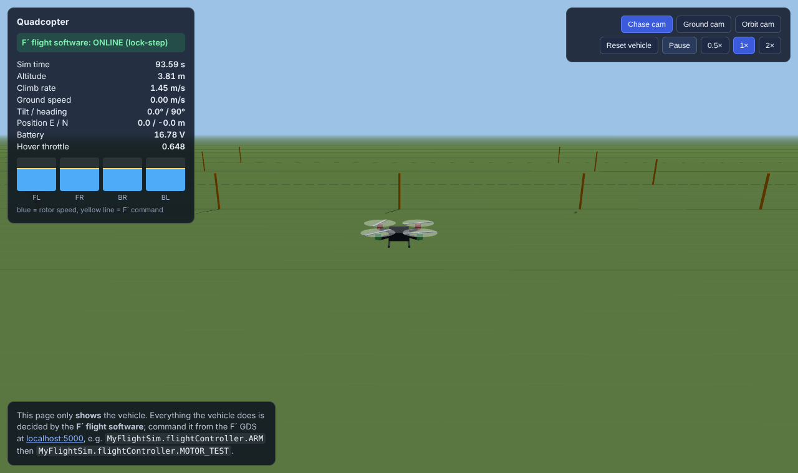
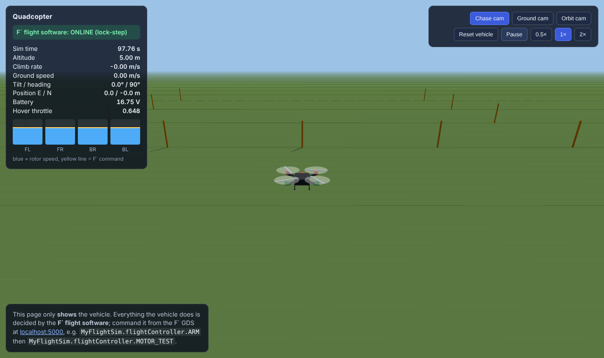
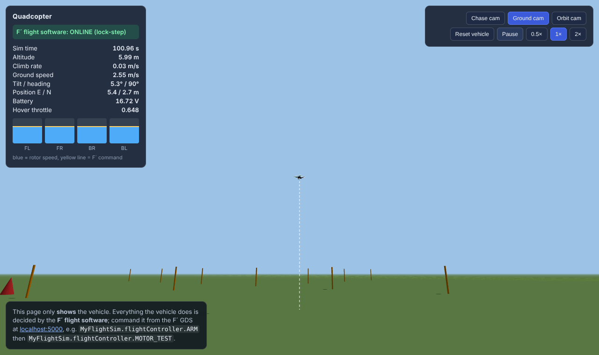
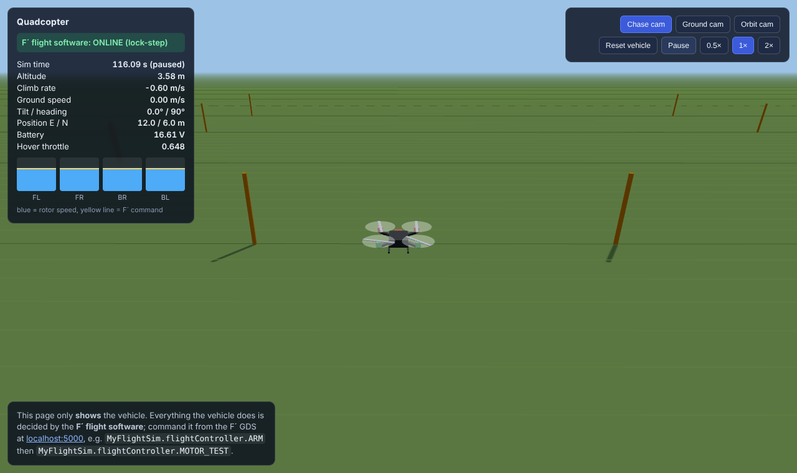
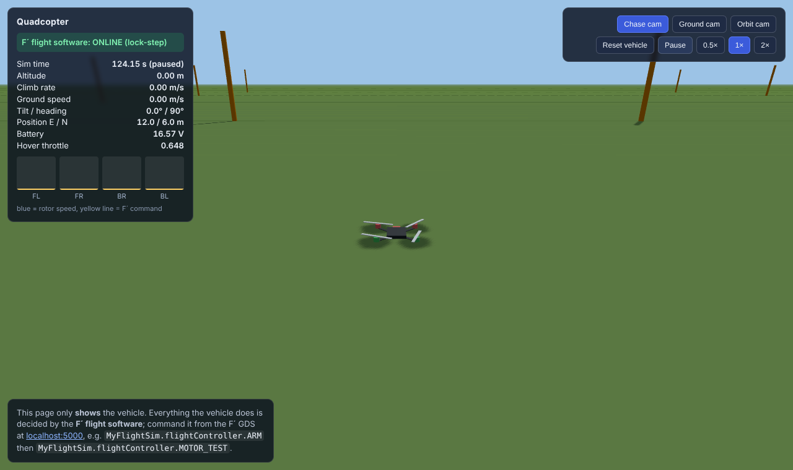
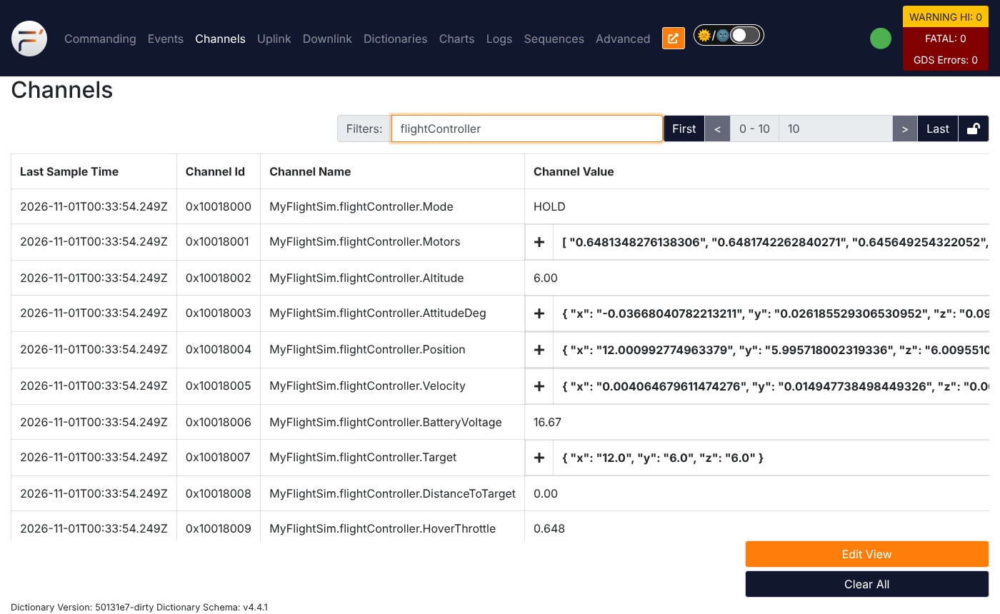
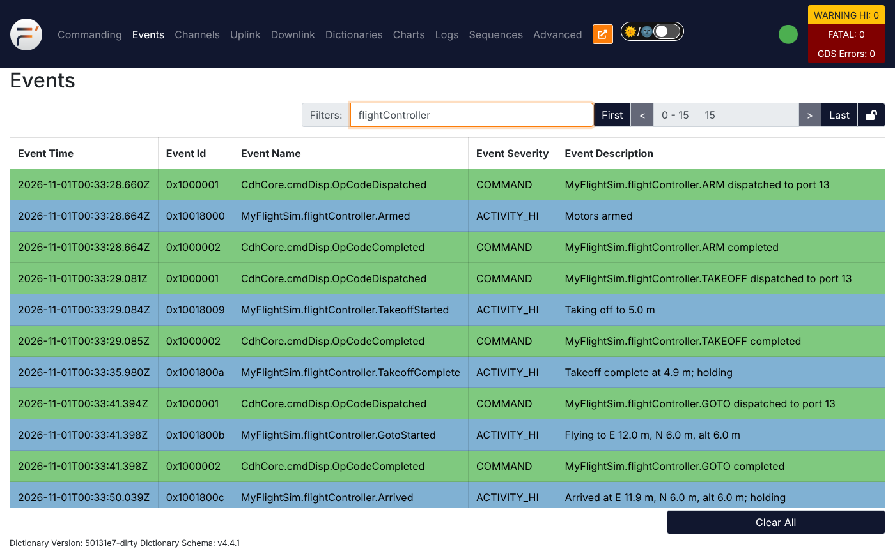

# 04 — Closed-loop flight: `TAKEOFF`, `GOTO`, `LAND`, and parameters

**Branch:** `feature/04-closed-loop-flight` (builds on `feature/03-physics-viewer-motors`)

**Goal:** turn `FlightController` into a real flight controller. After this
feature you can fly a mission entirely from the F´ ground system:

```
ARM → TAKEOFF 5 → GOTO 12 6 6 → LAND
```

and the quad climbs, holds, flies to the point, holds, descends and disarms
itself. You can also **retune it in flight** with F´ **parameters** and save
the new values so they survive a restart.

Everything new is inside `MyFlightSim/Components/FlightController/`. No other
component changed. The only topology-side change is where the parameter file
is saved (§1.6).

---

## 1. The F´ concepts this branch uses

### 1.1 Parameters

From `FlightController.fpp`:

```fpp
@ Maximum horizontal speed (m/s)
param MAX_SPEED: F32 default 3.0

@ Gravitational acceleration (m/s^2)
param GRAVITY: F32 default 9.81
...
param get port prmGetOut
param set port prmSetOut
```

> "A parameter is a typed constant value that you can update by command. For
> example, it could be a configuration constant for a hardware device or a
> software algorithm. F Prime has special support for parameters, including a
> parameter database component for storing parameters in a non-volatile manner
> (e.g., on a file system)."
>
> — FPP User's Guide, **§11.8 Parameters**
> (<https://nasa.github.io/fpp/fpp-users-guide.html#Defining-Components_Parameters>)

We have 16 parameters: 8 control gains, 4 limits (speed, climb, tilt, landing
speed), 3 vehicle properties (mass, motor thrust, **gravity**, which we'll
want for Mars), and the geofence radius.

**What FPP generated for each one:**

* a getter, `paramGet_MAX_SPEED(valid)`, used every control step in `readGains()`
* two commands, `MAX_SPEED_PRM_SET` and `MAX_SPEED_PRM_SAVE`. FPP User's Guide
  **§11.8 › Set and Save Opcodes**: "Each parameter that you specify has two
  implied commands: one for setting the value bound to the parameter locally in
  the component, and one for saving the current local value to the system-wide
  parameter database."
* an entry in the dictionary, so the GDS knows the names, types and defaults
* a hook we override, `parameterUpdated(id)`, called after a `PRM_SET`. We use
  it to warn (`ParamOutOfRange`) when a value will be clamped.

**Where the values live.** F´ docs, *Data Constructs* › **Parameters** and
**Parameter Database** (`lib/fprime/docs/user-manual/overview/04-cmd-evt-chn-prm.md`):

> "default value: default values are assigned in the event the parameter cannot
> be retrieved."

> "The parameter manager or database loads the file containing parameters from
> the file system during initialization. The initialization subsequently calls
> *loadParameters()* on components with parameters. … the set command updates
> the value of the parameter locally within the component that owns it, and the
> save command pushing the current value of the parameter to non-volatile
> storage, meaning it will persist within the files of the system across system
> resets."

So there are three levels:

| Step | Command | Where the value is |
|---|---|---|
| set | `MyFlightSim.flightController.MAX_SPEED_PRM_SET 1.0` | in the component only. Takes effect on the next control step; lost on restart |
| save | `MyFlightSim.flightController.MAX_SPEED_PRM_SAVE` | copied into `FileHandling.prmDb` (in memory) |
| write | `FileHandling.prmDb.PRM_SAVE_FILE` | written to `PrmDb.dat`; loaded again at every startup |

The `param connections instance FileHandling.prmDb` pattern line in
`topology.fpp` (feature 01) already wired our two param ports. Once again we
wrote **no wiring**.

### 1.2 Thread safety of parameters

`PRM_SET` commands run on the command dispatcher's thread, while `run` runs on
the 200 Hz rate group thread. We call `paramGet_*()` every step instead of
caching values in `parameterUpdated()`, because the generated getter locks the
component's parameter mutex. It's safe, and a new value is picked up on
the very next step.

### 1.3 Command design: validate arguments, then state

Each new command checks its **arguments** first (`VALIDATION_ERROR`: the
command could never work) and then the **vehicle state** (`EXECUTION_ERROR`:
it could work, but not right now):

| Command | Validation errors | Execution errors |
|---|---|---|
| `TAKEOFF(altitude)` | `InvalidAltitude` (outside 1–50 m) | `NotArmed`, `NotOnGround` |
| `GOTO(east, north, altitude)` | `InvalidAltitude`, `OutsideGeofence` | `NotFlying` |
| `LAND` | — | `NotFlying` |
| `MOTOR_TEST(level)` | `InvalidThrottle` | `NotArmed`, `NotOnGround` (new: not allowed in flight) |

Events with an **enum argument** (`NotFlying(mode: FlightMode)`) show the
mode by name in the GDS: "Rejected: the vehicle must be flying (mode
ARMED_IDLE)".

### 1.4 Events as the flight log

Every mode change emits an event (`TakeoffStarted`, `TakeoffComplete`,
`GotoStarted`, `Arrived`, `LandingStarted`, `Landed`). After a flight, the GDS
Events tab (and `logs/<date>/event.log`) tells you exactly what happened and
when. Operators of real missions rely on this record.

### 1.5 Keep the algorithm out of the component

The math (position → velocity → acceleration → attitude → rates → mixer) is
in `ControlLaw.hpp/.cpp`, a **plain C++ class with no F´ ports**.
`FlightController.cpp` is the F´ side: commands, modes, events, telemetry,
parameters. Each `run` it calls:

```cpp
motors = this->m_control.step(this->m_sensors, setpoint, gains, CONTROL_DT);
```

This mirrors how F´ itself is built: components are thin adapters around
reusable code. It also lets you test the algorithm without any F´ machinery.
Note how `ControlLaw` still uses F´ **types** (`SensorData`, `Vector3`,
`MotorThrottles`) generated from our FPP models, which you can do anywhere.

### 1.6 A deployment gotcha: where `PrmDb.dat` goes

`fprime-gds` launches the flight software with its `bin/` directory as the
working directory. The generated deployment saved parameters to `PrmDb.dat`
in that directory, and on the next run `fprime-gds` refused to start:

```
[ERROR] Multiple app candidates in binary location .../bin. Specify app manually with --app.
```

The fix, in `Top/QuadFswTopology.cpp`:

```cpp
FileHandling::prmDb.configure("../PrmDb.dat");
```

The file now lives at `build-artifacts/<platform>/MyFlightSim_QuadFsw/PrmDb.dat`.
**To go back to all-default parameters, delete that file.** It isn't in git.

### 1.7 Unit testing with parameters

In `test/ut/FlightControllerTester.cpp`:

* The constructor calls `this->component.loadParameters()`, like startup does.
  Without it every parameter reads as 0. (Our first test run failed exactly
  this way: the hover throttle came out as 0.22 instead of 0.648.)
* `paramSet_GRAVITY(3.71f, Fw::ParamValid::VALID)` + `paramSend_GRAVITY(0, cmdSeq)`
  act like the ground sending `GRAVITY_PRM_SET 3.71`. The test
  `HoverThrottleFollowsGravityParam` then checks the motors drop from 0.648 to
  √(1.2 × 3.71 / 28) = 0.399.
* 16 tests now cover every command, every rejection, the takeoff → hold,
  goto → hold and landing → disarm transitions, and parameter range warnings.
  Each test maps to a requirement in `docs/sdd.md`.

---

## 2. Files to read, in this order

1. `MyFlightSim/Components/FlightController/FlightController.fpp`: new enum
   values, commands, events, telemetry, and the `param` section.
2. `FlightController.cpp`: `run_handler`, then `TAKEOFF_cmdHandler`,
   `GOTO_cmdHandler`, `LAND_cmdHandler`, then `flyClosedLoop` (mode
   transitions), `readGains` and `parameterUpdated`.
3. `ControlLaw.cpp`: the control algorithm, in six numbered steps.
4. `docs/sdd.md`: requirements, mode diagram, parameter table.
5. `test/ut/FlightControllerTester.cpp`: the `Flight*` tests.
6. `MyFlightSim/QuadFsw/Top/QuadFswTopology.cpp`: the `prmDb.configure` change.

---

## 3. Build and unit test

```bash
. fprime-venv/bin/activate
```

```bash
cd MyFlightSim/QuadFsw && fprime-util build -j4
```

```bash
cd ../Components/FlightController && fprime-util generate --ut && fprime-util check
```

**Expect** `16 tests` passed: the 7 from feature 03 plus
`TakeoffClimbsThenHolds`, `HoverThrottleFollowsGravityParam`, `GotoArrives`,
`LandTouchdownDisarms`, `TakeoffRequiresArm`, `TakeoffValidatesAltitude`,
`CommandsCheckFlyingState`, `GotoGeofence`, `ParamOutOfRangeReported`.

---

## 4. Run it and test it

As in feature 03, with the venv active in each terminal:

```bash
cd MyFlightSim/QuadFsw && fprime-gds
```

```bash
python3 sim/server.py
```

Then open <http://localhost:8080> (viewer) and <http://localhost:5000> (GDS),
side by side.

### Test 1: a complete flight

In GDS → Commanding, send each command and wait for the event before the next:

| Send | Arguments | Expect (Events) | Expect (viewer) |
|---|---|---|---|
| `MyFlightSim.flightController.ARM` | — | `Armed` | props idle |
| `MyFlightSim.flightController.TAKEOFF` | altitude `5` | `TakeoffStarted` "Taking off to 5.0 m", ~4 s later `TakeoffComplete` | climbs straight up, stops at 5.00 m, **stays level and in place** |
| `MyFlightSim.flightController.GOTO` | `12`, `6`, `6` | `GotoStarted`, ~6 s later `Arrived` | tilts ~5° toward the target, flies at ~2.5 m/s (the `MAX_SPEED` 3 m/s limit is on the commanded speed), stops at E 12 / N 6 m, 6 m up |
| `MyFlightSim.flightController.LAND` | — | `LandingStarted` "0.60 m/s", ~10 s later `Landed` "Touchdown; motors disarmed" | descends at 0.6 m/s, touches down, props stop |







In **Channels** (filter `flightController`) while holding: `Mode` = `HOLD`,
`Target` = {12, 6, 6}, `DistanceToTarget` ≈ 0.00, and `Motors` ≈
`HoverThrottle` = 0.648:





Compare with feature 03: the same airframe and the same motors, but now the
flight software measures and corrects 200 times a second, so it no longer
tips over.

### Test 2: rejections

| Send | When | Expect |
|---|---|---|
| `GOTO 10 5 5` | armed, on the ground | `NotFlying` "(mode ARMED_IDLE)", `EXECUTION_ERROR` |
| `LAND` | on the ground | `NotFlying`, `EXECUTION_ERROR` |
| `TAKEOFF 60` | any | `InvalidAltitude`, `VALIDATION_ERROR` |
| `GOTO 200 0 5` | flying | `OutsideGeofence` "target is 200.0 m … geofence is 100.0 m", `VALIDATION_ERROR` |
| `MOTOR_TEST 0.5` | flying | `NotOnGround` "(mode HOLD)", `EXECUTION_ERROR`, and the quad keeps flying |

### Test 3: tune a parameter in flight

1. Take off and hold, as in Test 1.
2. Send `MyFlightSim.flightController.MAX_SPEED_PRM_SET` with `1.0`.
   **Expect** `OpCodeCompleted` for the command.
3. Send `GOTO 10 0 5`. **Expect** the quad to cruise at about **1 m/s** instead
   of 2.5 m/s (watch *Ground speed* in the viewer).
4. Send `MyFlightSim.flightController.MAX_TILT_DEG_PRM_SET` with `80`.
   **Expect** `ParamOutOfRange` "Parameter 10 = 80.000 is outside [5.000,
   45.000]; it will be clamped". (10 is `MAX_TILT_DEG`'s ID relative to the
   component.)
5. Try a gain: after `RATE_KP_PRM_SET 5`, attitude control is much softer.
   During a `GOTO` the quad tilts to about 30° instead of about 8° and wobbles
   as it accelerates and stops. `RATE_KP_PRM_SET 20` restores it.

### Test 4: make a parameter permanent

1. Send `MyFlightSim.flightController.MAX_SPEED_PRM_SAVE`, then
   `FileHandling.prmDb.PRM_SAVE_FILE`. **Expect** `PrmIdAdded` and
   `PrmFileSaveComplete` "Wrote 1 records".
2. Stop everything (Ctrl-C in both terminals) and start again.
3. **Expect** at startup (Events): `FileHandling.prmDb.PrmFileLoadComplete`
   "Records: 1". You'll also see `PrmIdNotFound` warnings for the
   parameters that were never saved; those use their FPP `default` values,
   which is fine.
4. Fly a `GOTO`. It's still slow (1 m/s): the value survived the restart.
5. To reset to defaults, stop the flight software and delete
   `build-artifacts/Linux/MyFlightSim_QuadFsw/PrmDb.dat` (`Darwin` on macOS).

### Test 5: pretend you're on Mars (a preview)

While hovering at 5 m, send `MyFlightSim.flightController.GRAVITY_PRM_SET 3.71`.
The simulator is still on Earth, so the controller now **under-estimates**
the thrust it needs by 62%. Watch `HoverThrottle` drop to 0.399 and the quad
sink, then settle about **1.4 m below** its target (around 3.6 m). The
vertical integral term (`VEL_Z_KI`) pulls as hard as its anti-windup limit
allows, but can't make up an error that large. Set it back to `9.81` and it
climbs back to 5 m. The flight software's model of the world
has to match the real world, and parameters are how you tell it. A later
feature runs the simulator on Mars.

---

## 5. Things to try

* Set `VEL_Z_KI_PRM_SET 0` and repeat Test 5. Without the integral term
  nothing compensates for the wrong model, and the quad sinks gently all the
  way to the ground. With correct parameters (`GRAVITY` 9.81), `VEL_Z_KI 0`
  makes almost no difference, because the model is right. Integral terms
  exist to cover model errors.
* Add a `HEADING(degrees)` command that changes `m_targetYaw`, with
  validation and a unit test. The yaw loop is already there.
* Open the GDS **Charts** tab and plot `MyFlightSim.flightController.Altitude`
  during a takeoff, then again after `VEL_Z_KP_PRM_SET 1`.
* Read `readGains()`: why clamp every value, when `parameterUpdated()` already
  warns? (Hint: parameters can also be loaded from `PrmDb.dat` at startup,
  without any `PRM_SET`.)
* Gotchas we hit: `low` and `high` are FPP keywords too (event severities), so
  the event arguments are `minimum` / `maximum`. And see §1.6 and §1.7.

---

## 6. What's next

Possible next features (each on its own branch):

* **Flight plans with command sequences.** Use the deployment's `Svc.CmdSequencer`
  (`cmdSeq`) to upload and run `ARM → TAKEOFF → GOTO → GOTO → LAND` as one
  file, the way real spacecraft are operated.
* **Mars mode.** Mars gravity and thin air in the simulator, a light-time delay
  on the ground link, and why sequences become the only way to fly.
* **Fault protection.** Health pings, a low-battery event that triggers an
  automatic landing, and sensor-failure handling.
* **Flight modes as an FPP state machine.** Replace the `switch` on
  `FlightMode` with FPP's built-in state machines (FPP User's Guide §10).
* **Pilot mode.** Keyboard or gamepad input from the viewer as a simulated radio
  receiver.
